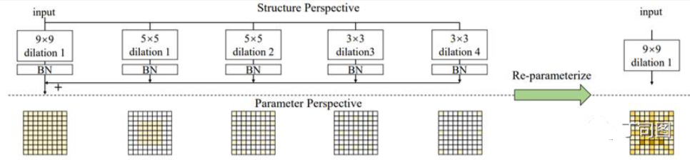
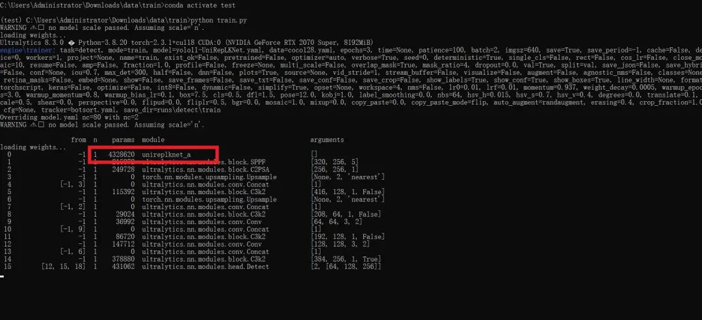

# [yolov11 Improvement Series] Python Source Code + Training Source Code for Using Large Convolutional Kernels in UniRepLKNet to Replace Backbone Based on yolov11

[UniRepLKNet Introduction]Large-kernel Convolutional Neural Networks (ConvNet) have recently received widespread research attention, but there are two unresolved issues.

[UniRepLKNet Introduction]

Large-kernel Convolutional Neural Networks (ConvNet) have recently received extensive research attention, but there are two unresolved key issues that require further investigation. 1) The architecture of existing large-kernel ConvNets largely follows the design principles of traditional ConvNets or Transformers, and the architecture design of large-kernel ConvNets has not yet been resolved. 2) Whether ConvNets possess strong general perception capabilities beyond vision remains to be studied. In this paper, we make contributions in two aspects. 1) We propose four architectural guidelines for designing large-kernel ConvNets, which focus on utilizing the essential characteristics of large kernels—being able to see broadly without delving deeply. Following these guidelines, our proposed large-kernel ConvNets demonstrate leading performance in image recognition. For example, our model achieves an ImageNet accuracy of 88.0%, a mIoU of 55.6% on ADE20K, and a COCO box AP of 56.4%, outperforming some of the recent strong competitors with better performance and higher speed. 2) We find that large kernels play a crucial role in performing exceptionally well in domains where ConvNets were originally less adept. Through certain modality-related preprocessing methods, even without specific modality-specific customization of the architecture, the proposed models can achieve state-of-the-art performance on time series prediction and audio recognition tasks.

Large Convolutional Kernel CNN Design:

-

-

Local Structure Design: Use SE, bottleneck, etc. to increase depth.

-

-

Reparameterization: Expansive convolutions to capture sparse features. This paper introduces a submodule called Dilated Reparam Block, which uses parallel expansive convolutions in addition to large kernel convolutions. Moreover, it leverages the concept of structural reparameterization, **equivalently converting the entire block into a large kernel convolution**. This is because **small kernel + expansive convolution is equivalent to large kernel + non-expansive convolution**. As shown in the figure below.

-

-

Regarding kernel size: Determine the kernel size based on the downstream task and the specific framework used; for the tasks involved in this paper, a 13x13 kernel is sufficient.

-

-

Regarding the scaling law: For a small model that has already been trained with many large kernels, when increasing the depth of the model (for example, from 18 layers in a Tiny-level model to 36 layers in a Base-level model), the added blocks should use depthwise 3x3 instead of adding more large kernels. The receptive field is already sufficient, but using such an efficient operation as 3x3 to enhance feature abstraction is always beneficial.

 Edit

What exactly is the advantage of large convolutional kernels? We believe it lies in their **large receptive fields**, which are not dependent on deep stacking. What does depth represent? On one hand, it signifies **higher-level feature abstraction**, and on the other hand, it represents **stronger general representation capabilities**. Our new architecture design principles stem from some reflections on these three concepts. Let's first compare these three concepts in detail.

-

-

The maximum receptive field describes the theoretical distance at which a point on the feature map can establish spatial connections with another point. For example, if I stack three 3x3 convolutional layers, the maximum receptive field would be 7x7, meaning that a point can theoretically connect to another point that is 5 units away. However, in actual CNNs, although there may theoretically be connections between two points, these connections are often realized through several layers and are very faint, having minimal impact on the final output. This introduces the concept of an effective receptive field. Theoretical analysis suggests that the effective receptive field of a model is proportional to the square root of the product of the kernel size and the number of layers [2]. In other words, as the number of layers increases, the marginal benefit of deepening the model to increase the effective receptive field diminishes. Research such as RepLKNet indicates that models like ResNet-152, despite having dozens of 3x3 convolutional layers, actually have a relatively small effective receptive field, and there is no substantial improvement over ResNet-101.

-

-

The hierarchy of feature abstraction is also related to spatial patterns. When discussing the receptive field, we focus on the model's ability to perceive "how wide a range," but beyond that, we also need to consider how high an abstract level the model can perceive. The intuitive explanation for convolutional neural networks is that the model extracts spatial patterns layer by layer using convolutional kernels, resulting in increasingly abstract features, from lines to textures, from textures to localized objects, and finally to objects. In addition to this intuitive abstraction level, the abstractions extracted by CNNs may be so complex that they are beyond human comprehension.

-

-

The general representation capability brought by depth is due to more trainable parameters and non-linear activation functions. Generally speaking, deeper and more parameterized models can fit more complex functions, thereby learning more complex representations.

What are the commonalities of traditional convolutional network architectures? We observe that when we add a 3x3 or 5x5 convolution layer to the network, we actually expect it to **generate three effects simultaneously: increase receptive field, enhance abstraction level, and generally improve representation capability by increasing depth.**

What limitations does this impose on the design of traditional convolutional networks?

-

-

Small convolutional kernels must be stacked in large quantities to achieve a large receptive field, so we need many 3x3 or 5x5 layers, and the final effect is not good.

-

-

The number of convolutional layers is increased, which naturally ensures adequate feature abstraction. However, what level of abstraction is deemed sufficient? No one knows, because this thing is tightly coupled with the sensory field and can't be adjusted separately.

-

-

Convolutional layers consume excessive parameters and computational resources, making it challenging to further enhance their general representation capabilities under the constraints of model size.

With the enhancement of large convolutional kernels, we can achieve sufficient effective receptive fields with only a few large convolutional kernels. What might go wrong if we follow the traditional CNN stacking convolutional kernel design paradigm?

-

-

The receptive field might be too large. This issue is not just a waste of computational power. For some downstream tasks' frameworks (such as the semantic segmentation UperNet), the early layers in the backbone may prematurely obtain a large receptive field, which can have negative effects (the low-layer features should be local features; UperNet combines them with high-layer features to achieve better performance; now, if the low-layer receptive fields are also large, they will become global features).

-

-

Under the premise that the sensory field is fully sufficient, the simple task of transforming lower-level abstract features into higher-level abstract features can be accomplished with a depthwise 3x3. I insist on using a 31x31 instead, which is indeed unnecessary.

-

-

The model may achieve a large receptive field with only a few layers, but if we stop at such depth (as RepLKNet only uses 24 ultra-large convolutional layers and 24 FPN structures), the model's representation capability may be insufficient.

What principles should we follow in designing a large convolutional neural network (CNN) architecture? Our answer is to **decouple the three elements mentioned above and use the corresponding structure to achieve the desired effect.** The ability to achieve such decoupling is precisely what makes large convolutional kernels their inherent advantage.

-

-

Ensure a large receptive field with a small number of large convolutional kernels.

-

-

Enhance feature abstraction levels using small convolutions such as depthwise 3x3.

-

-

Utilize some efficient structures (such as SE Block, Bottleneck structure, etc.) to enhance the model's depth and thereby strengthen its general representation capabilities.

Under this thought, we have conducted a series of systematic studies and proposed four Architectural Guidelines for the design of large-kernel CNNs. The simple summary is as follows:

-

-

Regarding local structure design: Use some efficient structures like SE or bottleneck to increase depth.

-

-

Reparameterization for Expansions: Capturing sparse features with dilated convolutions. This paper introduces a submodule called Dilated Reparam Block, which uses parallel dilated convolutions in addition to large kernel convolutions. Moreover, it leverages the concept of structural reparameterization, **equivalently transforming the entire block into a large kernel convolution**. This is because **small kernel + dilated convolution is equivalent to large kernel + non-dilated convolution**. As shown in the figure below.

-

-

Regarding kernel size: The choice of kernel size should be determined based on the downstream task and the specific framework used. As mentioned earlier, for the semantic segmentation framework UperNet, having too large a receptive field early in the feature layer may have negative effects. However, this does not mean that a larger kernel will reduce the model's representational ability or the quality of the final features! The conclusion drawn by RepLKNet that "enlarging the kernel size at least doesn't worsen" is not refuted (RepLKNet uses DeepLabv3 for semantic segmentation, which is not dependent on the locality of low-level features). It has been corrected. For the tasks involved in this paper, a 13x13 kernel size is sufficient.

-

-

Regarding the scaling law: For a small model that has already been trained with many large kernels, when increasing the depth of the model (for example, from 18 layers in a Tiny-level model to 36 layers in a Base-level model), the added blocks should use depthwise 3x3 instead of adding more large kernels. The receptive field is already sufficient, but using such an efficient operation as 3x3 to enhance feature abstraction is always beneficial.

[Introduction to YOLOv11 Framework]

On September 30, 2024, Ultralytics officially released YOLOv11 during its event YOLOVision. YOLOv11 is the latest version of YOLO, developed by the team from both the United States and Spain, Ultralytics. YOLO stands for You Only Look Once, a computer vision algorithm used in image-based artificial intelligence.

### Ultralytics YOLO11 Overview

YOLO11 is the latest version of the Ultralytics YOLO series of real-time object detectors, redefining possibilities with cutting-edge precision, speed, and efficiency. Building on impressive advancements from previous YOLO versions, YOLO11 introduces significant improvements in architecture and training methods, making it a versatile choice for various computer vision tasks.


Editor

Key Features

-

-

Enhanced feature extraction: YOLO11 employs an improved backbone and neck architecture, enhancing feature extraction capabilities to achieve more precise object detection and complex task performance.

-

-

Optimization for efficiency and speed: YOLO11 introduces refined architecture design and optimized training pipelines, providing faster processing speeds while maintaining the best balance between accuracy and performance.

-

-

Achieving higher accuracy with fewer parameters: With the advancement of model design, YOLOv11m has achieved higher average precision (mAP) on the COCO dataset while using 22% fewer parameters than YOLOv8m, thereby improving computational efficiency without compromising accuracy.

-

-

Cross-environment adaptability: YOLO11 can be seamlessly deployed in various environments, including edge devices, cloud platforms, and systems supporting NVIDIA GPUs, ensuring maximum flexibility.

-

-

Supports a wide range of tasks: whether it's object detection, instance segmentation, image classification, pose estimation, or Oriented Object Detection (OBB), YOLO11 aims to tackle various computer vision challenges.

 Edit

#### Compared to previous versions, what are the key improvements in Ultralytics YOLO11?

Ultralytics YOLO11 introduces several significant improvements compared to its predecessor. The main improvements include:

-

-

Enhanced feature extraction: YOLO11 employs an improved backbone and neck architecture, enhancing feature extraction capabilities to achieve more precise object detection.

-

-

Optimized efficiency and speed: Precise architectural design and optimized training pipelines provide faster processing speeds while maintaining a balance between accuracy and performance.

-

-

Achieving higher accuracy with fewer parameters: YOLOv11m achieves higher average precision (mAP) on the COCO dataset, reducing its parameters by 22% compared to YOLOv8m, while improving computational efficiency without compromising accuracy.

-

-

Cross-environment adaptability: YOLO11 can be deployed across various environments, including edge devices, cloud platforms, and systems supporting NVIDIA GPUs.

-

-

Supports a wide range of tasks: YOLO11 supports various computer vision tasks, such as object detection, instance segmentation, image classification, pose estimation, and Oriented Object Detection (OBB).

[Test Environment]

windows10 x64

ultralytics==8.3.0

torch==2.3.1

RTX 2070 graphics card with 8GB, using the improved source code recommends a memory size of >= 6GB, and does not limit the graphics card model.

[Improvement Process]

1. Add a new module called UniRepLKNet.py to implement the functionality (the code is too extensive, please refer to the improved steps in the docx file for the core module source code). Then create a __init__.py file under the same directory and write the code.

from .UniRepLKNet import *

#### 2. File modification steps

**Modify tasks.py file**

**Create Model Configuration File**

The content of yolo11-UniRepLKNet.yaml is as follows:

```
# Ultralytics YOLO 🚀, AGPL-3.0 license
# YOLO11 object detection model with P3-P5 outputs. For Usage examples see https://docs.ultralytics.com/tasks/detect
# Parameters
nc: 80 # number of classes
scales: # model compound scaling constants, i.e. 'model=yolo11n.yaml' will call yolo11.yaml with scale 'n'
  # [depth, width, max_channels]
  n: [0.50, 0.25, 1024] # summary: 319 layers, 2624080 parameters, 2624064 gradients, 6.6 GFLOPs
  s: [0.50, 0.50, 1024] # summary: 319 layers, 9458752 parameters, 9458736 gradients, 21.7 GFLOPs
  m: [0.50, 1.00, 512] # summary: 409 layers, 20114688 parameters, 20114672 gradients, 68.5 GFLOPs
  l: [1.00, 1.00, 512] # summary: 631 layers, 25372160 parameters, 25372144 gradients, 87.6 GFLOPs
  x: [1.00, 1.50, 512] # summary: 631 layers, 56966176 parameters, 56966160 gradients, 196.0 GFLOPs
# 0-P1/2
# 1-P2/4
# 2-P3/8
# 3-P4/16
# 4-P5/32
# YOLO11n backbone
backbone:
  # [from, repeats, module, args]
  - [-1, 1, unireplknet_a, []]  # 4
  - [-1, 1, SPPF, [1024, 5]]  # 5
  - [-1, 2, C2PSA, [1024]] # 6
# YOLO11n head
head:
  - [-1, 1, nn.Upsample, [None, 2, "nearest"]]
  - [[-1, 3], 1, Concat, [1]] # cat backbone P4
  - [-1, 2, C3k2, [512, False]] # 9
  - [-1, 1, nn.Upsample, [None, 2, "nearest"]]
  - [[-1, 2], 1, Concat, [1]] # cat backbone P3
  - [-1, 2, C3k2, [256, False]] # 12 (P3/8-small)
  - [-1, 1, Conv, [256, 3, 2]]
  - [[-1, 9], 1, Concat, [1]] # cat head P4
  - [-1, 2, C3k2, [512, False]] # 15 (P4/16-medium)
  - [-1, 1, Conv, [512, 3, 2]]
  - [[-1, 6], 1, Concat, [1]] # cat head P5
  - [-1, 2, C3k2, [1024, True]] # 18 (P5/32-large)
  - [[12, 15, 18], 1, Detect, [nc]] # Detect(P3, P4, P5)
```

#### 3. Verification of integration

Search for the source code of futureflsl/yolo-improve using Git, then use the newly created yaml configuration file to start the training task.

```
from ultralytics import YOLO
if __name__ == '__main__':
    model = YOLO('yolo11-UniRepLKNet.yaml')  # build from YAML and transfer weights
        # Train the model
    results = model.train(data='coco128.yaml',epochs=100, imgsz=640, batch=8, device=0, workers=1, save=True,resume=False)
```

After successful integration, the training log will display initialization information for the UniRepLKNet module, indicating that it has been correctly loaded into the model.

 Editor

[Training Instructions]

Step 1: First, install the necessary modules for YOLOv11. You can refer to the installation process of the YOLOv11 framework. Then, uninstall the official version of pip by running `pip uninstall ultralytics`. Finally, install the improved source code by running `pip install .`
Step 2: Place your dataset in a folder named 'dataset' and ensure that the folder names remain unchanged.
Step 3: Open the train.py, coco128.yaml, and model parameters yaml files separately and modify the necessary parameters. Finally, execute `python train.py` to train.

[Provided Files]

```
├── [Official Source Code]ultralytics-8.3.0.zip
├── train/
│   ├── coco128.yaml
│   ├── dataset/
│   │   ├── train/
│   │   │   ├── images/
│   │   │   │   ├── firc_pic_1.jpg
│   │   │   │   ├── firc_pic_10.jpg
│   │   │   │   ├── firc_pic_11.jpg
│   │   │   │   ├── firc_pic_12.jpg
│   │   │   │   ├── firc_pic_13.jpg
│   │   │   ├── labels/
│   │   │   │   ├── classes.txt
│   │   │   │   ├── firc_pic_1.txt
│   │   │   │   ├── firc_pic_10.txt
│   │   │   │   ├── firc_pic_11.txt
│   │   │   │   ├── firc_pic_12.txt
│   │   │   │   ├── firc_pic_13.txt
│   │   └── val/
│   │       ├── images/
│   │       │   ├── firc_pic_100.jpg
│   │       │   ├── firc_pic_81.jpg
│   │       │   ├── firc_pic_82.jpg
│   │       │   ├── firc_pic_83.jpg
│   │       │   ├── firc_pic_84.jpg
│   │       ├── labels/
│   │       │   ├── firc_pic_100.txt
│   │       │   ├── firc_pic_81.txt
│   │       │   ├── firc_pic_82.txt
│   │       │   ├── firc_pic_83.txt
│   │       │   ├── firc_pic_84.txt
│   ├── train.py
│   ├── yolo11-UniRepLKNet.yaml
└── training_notes.txt
├── [Improved Source Code]ultralytics-8.3.0.zip
├── Improvement Principles.docx
└── Improved Process.docx
```

[Common Issues Summary]
Question: Why does the map of my model's epoch display as 0 or have very low accuracy?
Answer: Due to the source code being improved, it is not possible to directly fine-tune from the official model. Instead, training from scratch is required, which will result in weaker learning of features and requires many epochs for effects to emerge. Moreover, since the improved source code framework may not necessarily guarantee surpassing the official accuracy, there is also a possibility of achieving far worse results or even very low precision. This indicates that the improved framework does not yield good results. Therefore, for framework improvements, it merely provides a viable solution. Whether the improvements can lead to excellent performance still needs to be confirmed based on actual training conditions. Of course, this does not rule out the possibility of dataset issues, such as a single dataset, unbalanced sample distribution, limited generalization scenarios, poor annotation quality, and small detection targets among other reasons.
[Important Notice]
We only offer one improvement framework solution, and we do not guarantee that it will achieve excellent training accuracy or even surpass the accuracy of official models. The improvement framework is actually a complex process including the feasibility of the framework principle, whether the training dataset is appropriate, the need for back-propagation validation, as well as the comparison of parameter results from similar frameworks. This is a very complex and lengthy process.


## Payment

Here is a pay link on Stripe ( https://buy.stripe.com/3cs8yP7sY87d0vu9AB ). Please contact me lonlonago@foxmail.com after funding $89, and I will send you a complete data files , thank you!


